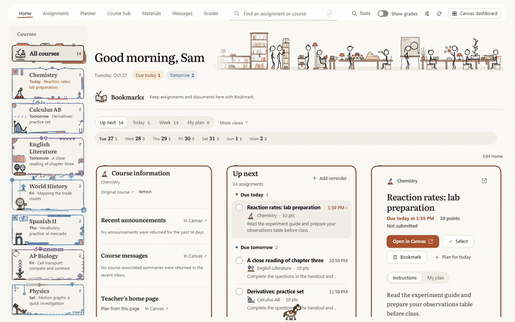
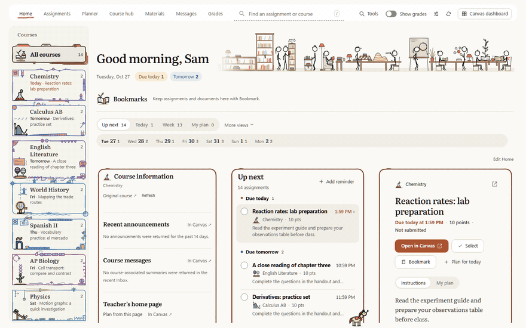
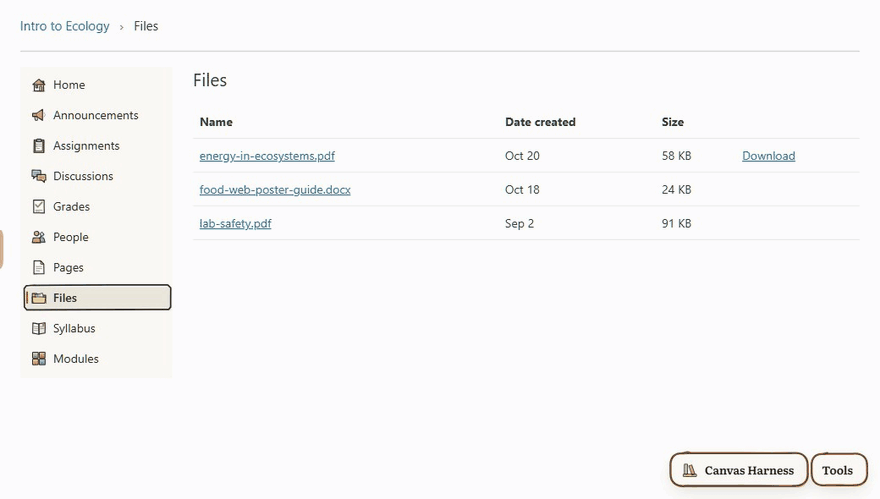
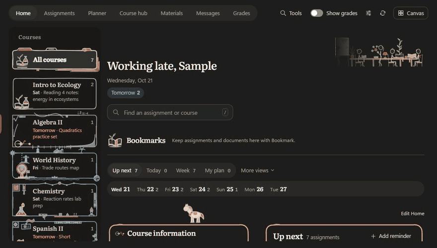
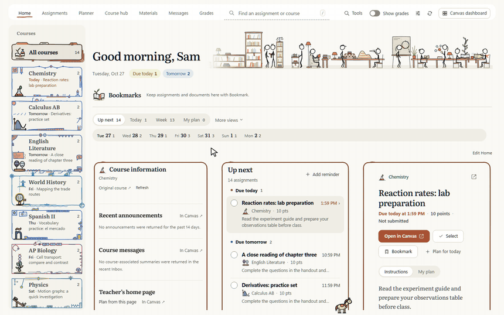
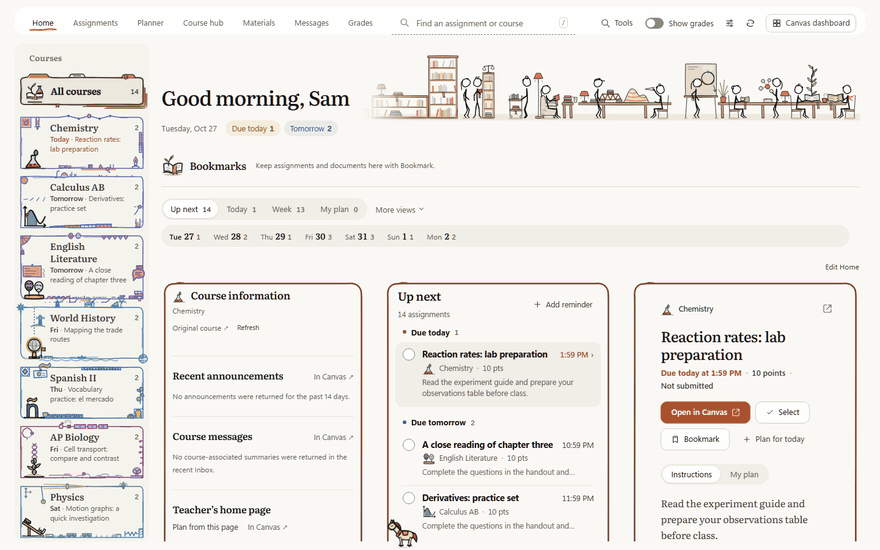

<h1 align="center">
  
</h1>

  <b>A free Chrome and Edge extension that redraws Canvas LMS for students.</b> 
  Open your school's Canvas as usual and it becomes one calm page: 
  everything due beside its instructions, in a workspace you arrange and draw your way.

  
  
  
  
  

  <a href="https://chromewebstore.google.com/detail/bppjpjpbichfcbgajlppkgbbncbfohgd"><b>Add to Chrome</b></a> ·
  <a href="https://github.com/Flzsh/canvas-harness/releases/latest">Download</a> ·
  <a href="INSTALL.md">Install</a> ·
  <a href="PRIVACY.md">Privacy</a>

<table>
<tr>
<td width="50%" valign="top"> <b>Your Canvas Home, rebuilt</b> Pick the modules you want and drag them into place.</td>
<td width="50%" valign="top"> <b>Plan the week</b> Your Canvas assignments, with your own tasks: type “essay fri 45m” and it lands on Friday.</td>
</tr>
<tr>
<td valign="top"> <b>Course PDFs beside your work</b> Open a Canvas file, then highlight, note and mark up without a new tab.</td>
<td valign="top"> <b>Make it yours</b> Every choice is a picture: layout, colour, type, outline.</td>
</tr>
<tr>
<td valign="top"> <b>Themes</b> Under the Sea, Starry Night, Starfield and Blueprint.</td>
<td valign="top"> <b>Biscuit</b> A small pony that knows what is next. One switch turns it off.</td>
</tr>
</table>

Every demo is Canvas with Canvas Harness switched on, using made-up courses and assignments.

## New in 4.2

- **A new Planner**: the day as a tick list, the week or the month beside it, a day button on every assignment, and "Add a task" from any tab.
- **Home you can arrange**: drag a module, make it wider or narrower, and put it back with one press.
- **Soul Passage**, a study carriage on a train that never stops, with a different land outside on each day of the week. It is the first **Megapack**: its pictures come down from the Market when you choose it, and Remove deletes them.
- **Maple Frost**, a new scene in the Seasonal pack: Maple Wind's hillside a season on, under snow.
- **On assignment pages**: "Open beside" to read another assignment next to the one you are on, and a switch that turns Canvas Harness off there (nothing of it drawn but the switch, nothing asked of Canvas).
- **Make it yours** in a clearer order: Scenes, Look, Home, Courses, Companion, Settings.

## New in 4.1

- **Christmas**, a new scene in the Holiday pack: a market town on Christmas Eve in pixel art, with falling snow.
- **Theme packs with a band**: a theme from the Market or a file can paint a moving band across the top of Home and bring a companion of its own.
- **AI help fits Gemini's chat box**, and says so plainly when a message is too long for it.

## New in 4.0

- **AI help, an optional add-on.** It is in the package but off, and nothing of it shows, until you add it from the Market and agree to a short notice. Then: Help cards for an assignment, a PDF or a selection (practice tests, reading breakdowns, worked examples, writing outlines), Daily AI help, a Today list and study aids, from the AI website you pick or your own API key. Biscuit can hand it a question. Switch it off, or remove the add-on, and it locks again. [How it works](AI.md)
- **Biscuit understands far more.** Name a tool and it opens; ask about tests and it lists the ones ahead; his answers are cards and lists with buttons, and a question never changes anything.
- **Canvas's menu as one tidy bar**, across the top or down the side, at every window size and zoom; extra items fold into More.
- **A slip after Archive or Mark done** says what changed, with Put back for each item and Undo all.
- **Home modules keep their shape** when you move or resize them, and a move can be undone.
- **Maple Wind paints the whole page**, and the banner no longer jumps when you select work.
- **Fixes** from a check of every page, theme and setting, including the dashboard right after a school sign-in.
- **Easier to read over the scenes**: under Thanksgiving and Blueprint the date, a course's links and More views sit on their own paper or pane.

Also in 3.10: the Thanksgiving and Maple Wind scenes, scenes that fit above your widgets at any window size, Deadline changes redrawn and faster clicks. In 3.9: Focus room, Review deck and Grade impact as rooms that grow out of their Home modules, a drawn top bar, Graphics from Low to Extra high, play tools that take the whole page, Developer tools and a reading ruler in the PDF reader. Thanks to @garywu000 and @HarryX081125 for their contributions. [Every change](CHANGELOG.md)

## Install

**Chrome Web Store:** [Add to Chrome](https://chromewebstore.google.com/detail/bppjpjpbichfcbgajlppkgbbncbfohgd). Edge can install it from the same page. It updates by itself.

**From GitHub:** download the ZIP from the [latest release](https://github.com/Flzsh/canvas-harness/releases/latest), open `chrome://extensions`, turn on Developer mode and choose **Load unpacked**.

Works on `*.instructure.com` and on your school's own Canvas address once you add it in the popup. Needs Chrome or Edge 126 or newer. [Help](INSTALL.md)

## Privacy

Everything you make stays in your browser: no ads, no analytics, no server of ours. It never changes submissions or grades. [Details](PRIVACY.md)

  <a href="docs/GETTING-STARTED.md">Guide</a> ·
  <a href="docs/THEMES.md">Themes</a> ·
  <a href="docs/TESTING.md">Tests</a> ·
  <a href="https://github.com/Flzsh/canvas-harness/issues">Report a bug</a>

Made by Flzsh · <a href="LICENSE">GPL-3.0-only</a> · <a href="extension/NOTICE.txt">Third-party notices</a> 
An independent project, not affiliated with or endorsed by Instructure. Canvas is a trademark of Instructure, Inc.

