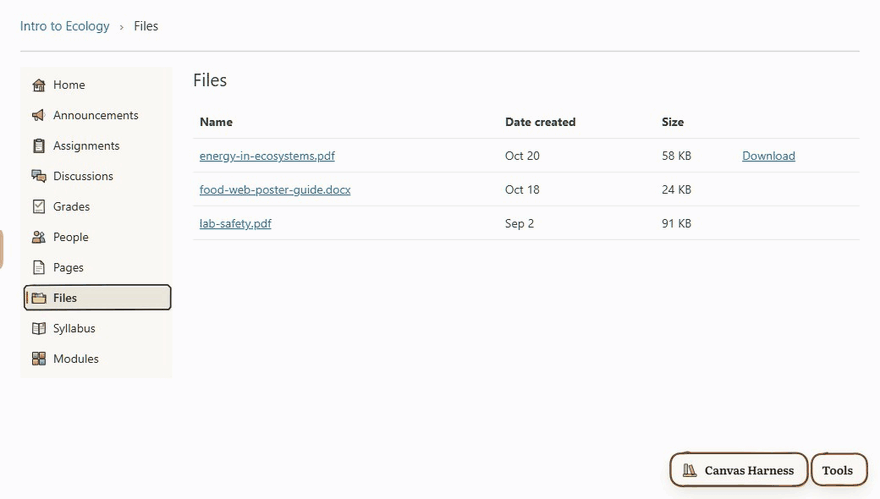
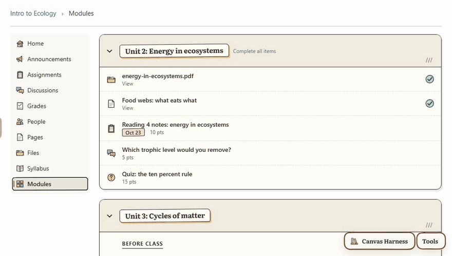
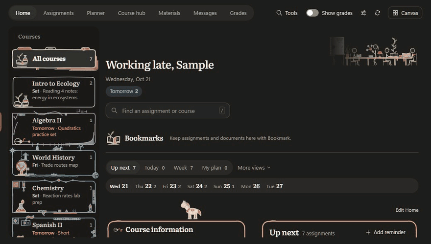
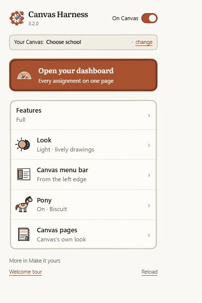

<h1 align="center">
  
</h1>

  <b>A Canvas workspace you build yourself.</b> 
  Everything due, the instructions, your PDFs and your plan on one calm page, drawn by hand.

  
  
  
  

  <a href="https://chromewebstore.google.com/detail/bppjpjpbichfcbgajlppkgbbncbfohgd"><b>Add to Chrome</b></a> ·
  <a href="https://github.com/Flzsh/canvas-harness/releases/latest">Download</a> ·
  <a href="INSTALL.md">Install</a> ·
  <a href="docs/GETTING-STARTED.md">Get started</a> ·
  <a href="PRIVACY.md">Privacy</a>

Canvas shows you everything. Canvas Harness shows you what to do next. It replaces the Canvas dashboard with a page you arrange yourself, and Canvas's own pages are always one click away.

- **Find your work faster.** Every assignment sits beside its instructions, so there is no course card, assignment list, detail page and pile of tabs.
- **Read and plan in one place.** PDFs open beside your work, and a planner turns "essay outline fri 45m" into a card on Friday.
- **Comfortable to use.** Hand-drawn artwork for every course, light or dark, and only the features you switch on.

Every demo below uses fictional courses and assignments.

## New in 3.4

- Use your own picture or short video as a banner, framed the way you want. Upload, drop or paste it into Make it yours, then choose the fit, focus, zoom and height. Course cards and a dimmed page background can use your art too. Video loops and stills, framing and media carry over in kits and personal backups.

- Ask Biscuit for focus time, a break, a reminder or a plan in the words you use. It also finds settings, features, tabs, notes and bookmarks, with Undo after a change. Set its skills, routines and quiet time yourself.
- A submitted assignment can unlock one random play tool and a drawn celebration. Powerful tools are rarer.
- Pick Starry Night, Under the Sea, Starfield or Blueprint, and try the drawn course dock in Make it yours.
- Open the optional Market from the popup, or use Add from a file for artwork, kits, themes, pets and presets. Installed add-ons can be removed. [File formats and checker](docs/portable-packs.md).
- Modules progress and To hand in help find the next step. Focus room, Review deck and Grade impact are optional switches in Custom, off by default in Full and Lite. Thanks to @garywu000 for the contributions.
- Full, Lite and Custom keep your saved data when you switch. Lite leaves out scene themes, play and media playback; saved artwork stays in your backups.

[Everything that changed](CHANGELOG.md)

## Build your Home

  

**Edit Home** switches modules on and off: Today, This week, Focus timer, Clock, Notes, Bookmarks, Grades and Messages. Each module's three-dot menu sets its width or gives it a whole row. To move one, hold its heading until the hand-drawn circle closes, then drag it. **Undo move** puts things back.

## Plan the week

  

Type a task in plain words and it lands on the right day with its time and course. Drag cards between days and tick them off. Canvas due dates never change.

## Read your PDFs where you work

  

Click a PDF anywhere in a course and it opens in a reader beside the page instead of a new tab. Jump by page or outline, find words, highlight in colour and write notes in the margin; they stay in your browser. **Ask AI** takes the pages or text you choose to the AI pane, where you review it before anything is sent. Assignment and submission pages stay exactly as Canvas made them until you click a PDF. [PDF reader details](docs/pdf-reader.md).

The reader also exports your highlights, underlines and margin notes as a Markdown or plain-text study sheet, grouped by page. Choose **Export highlights and notes** in the reader’s heading.

## Canvas's own pages, drawn to match

  

The course menu, the Modules page and Canvas's menu bar on the left get the same hand-drawn icons and outlines. Canvas's order, words, links, requirements and locked states stay as they are.

## Make it yours

  

Courses get animated subject artwork automatically. **Make it yours** has five tabs of picture choices: Layout, Look, Artwork, Courses and Pony. For your own art, describe your course to an AI with the free [artwork skill](skills/canvas-harness-art/SKILL.md) and drop the `.chpack` it makes into **Quick Upload**, or upload your own SVG banners, icons, frames and titles.

## Only what you use

  

Open the popup and choose **Features**. **Full** has everything. **Lite** keeps the dashboard, Planner and Home modules, grades, math and study tools. **Custom** remembers your own switches and adds anything a feature needs. Reload Canvas to apply a change.

## Also inside

- **A study companion.** A small hand-drawn pony walks along your modules, tells you what is next, studies beside a running timer and cheers finished work. It never scolds, and one switch turns it off.
- **Tools beside your work.** Desmos, GPA estimates and an AI hand-off in a side dock while you read. You pick what is shared and see it before anything is sent.
- **Light on slower laptops.** It comes back quickly when you return to the tab and does very little while it sits idle.

## Install in Chrome or Edge

**From the Chrome Web Store (easiest):** open [Canvas Harness on the Chrome Web Store](https://chromewebstore.google.com/detail/bppjpjpbichfcbgajlppkgbbncbfohgd) and click **Add to Chrome**. A welcome page asks for your school's Canvas address, then opens it. Edge can install it from the same page after you allow extensions from other stores. Store installs update by themselves.

**From GitHub instead:**

1. Download and extract the extension ZIP from the [latest release](https://github.com/Flzsh/canvas-harness/releases/latest).
2. Open `chrome://extensions` or `edge://extensions`, turn on Developer mode, and choose **Load unpacked**.
3. Select the folder containing `manifest.json`, then refresh Canvas.

Works on school sites under `*.instructure.com`, and on a school's own Canvas address once you add it in the popup (your browser asks to allow that one site). [Installation help](INSTALL.md).

## Privacy

Canvas Harness uses the Canvas session you are already signed in to and never changes submissions or grades. Plans, notes, PDF highlights, artwork and settings stay in your browser, kept apart per account; there are no ads, no analytics and no developer server. By default nothing saved is shown until Canvas confirms who is signed in. The AI hand-off sends only what you select, to the AI website you choose, after you review it. [Privacy details](PRIVACY.md).

## Contributing

Bug reports and ideas are welcome in [Issues](https://github.com/Flzsh/canvas-harness/issues). Pull requests are read carefully; changes are fitted into the next release so everything keeps one look. [How to run the tests](docs/TESTING.md).

  <a href="docs/GETTING-STARTED.md">User guide</a> ·
  <a href="docs/THEMES.md">Themes</a> ·
  <a href="AI.md">AI guide</a> ·
  <a href="https://github.com/Flzsh/canvas-harness/issues">Report a bug</a>

Created by Flzsh · <a href="LICENSE">GPL-3.0-only</a> · <a href="extension/NOTICE.txt">Third-party notices</a>

