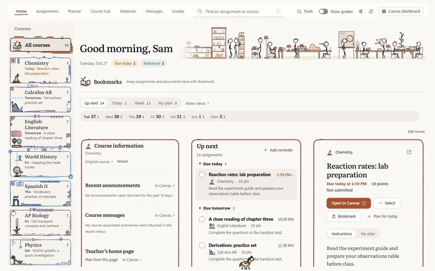
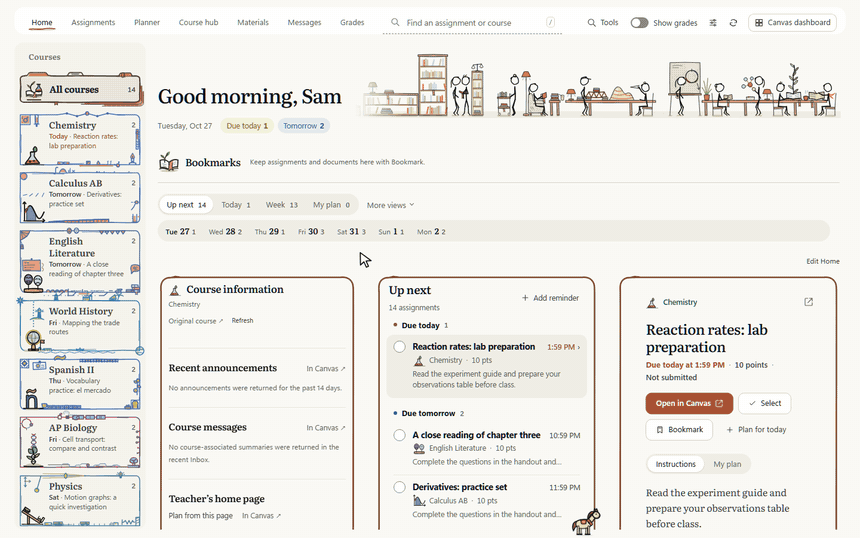
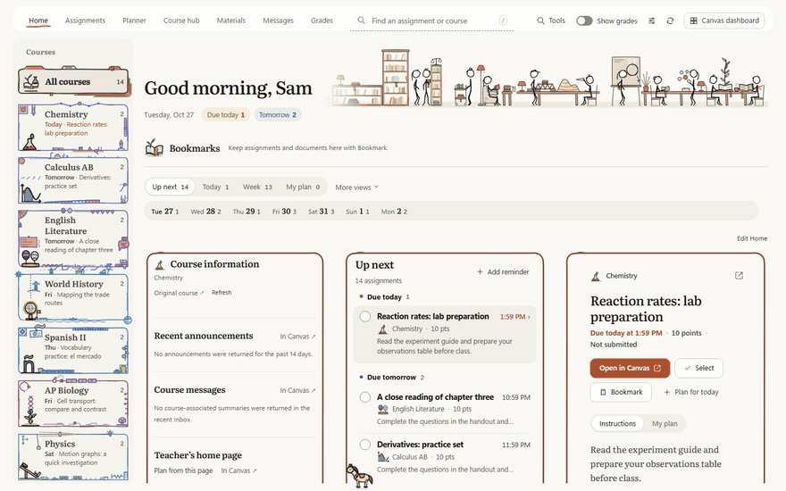

<h1 align="center">
  
</h1>

  <b>Your Canvas, on one calm page.</b> 
  Everything due beside its instructions, in a workspace you arrange and draw your way.

  
  
  
  

  <a href="https://chromewebstore.google.com/detail/bppjpjpbichfcbgajlppkgbbncbfohgd"><b>Add to Chrome</b></a> ·
  <a href="https://github.com/Flzsh/canvas-harness/releases/latest">Download</a> ·
  <a href="INSTALL.md">Install</a> ·
  <a href="PRIVACY.md">Privacy</a>

<table>
<tr>
<td width="50%" valign="top"> <b>Build your Home</b> Pick the modules you want and drag them into place.</td>
<td width="50%" valign="top"> <b>Plan the week</b> Type “essay fri 45m” and it lands on Friday.</td>
</tr>
<tr>
<td valign="top"> <b>PDFs beside your work</b> Highlight, note and mark up without a new tab.</td>
<td valign="top"> <b>Make it yours</b> Every choice is a picture: layout, colour, type, outline.</td>
</tr>
<tr>
<td valign="top"> <b>Themes</b> Under the Sea, Starry Night, Starfield and Blueprint.</td>
<td valign="top"> <b>Biscuit</b> A small pony that knows what is next. One switch turns it off.</td>
</tr>
</table>

Every demo uses made-up courses and assignments.

## New in 3.6

- **Make it yours, redrawn.** Pictures for every choice on drawn cards, and its tabs switch several times faster.
- **A new top bar**: the tabs are words, the open one underlined by hand, and the search sits on a dashed line.
- **Biscuit's settings now stick**: bedtime (also after midnight), offers, skills and where it walks.
- **Opens reliably** after you leave the tab while Canvas is still loading.

Thanks to @garywu000 and @HarryX081125 for their contributions. [Every change](CHANGELOG.md)

## Install

**Chrome Web Store:** [Add to Chrome](https://chromewebstore.google.com/detail/bppjpjpbichfcbgajlppkgbbncbfohgd). Edge can install it from the same page. It updates by itself.

**From GitHub:** download the ZIP from the [latest release](https://github.com/Flzsh/canvas-harness/releases/latest), open `chrome://extensions`, turn on Developer mode and choose **Load unpacked**.

Works on `*.instructure.com` and on your school's own Canvas address once you add it in the popup. [Help](INSTALL.md)

## Privacy

Everything you make stays in your browser: no ads, no analytics, no server of ours. It never changes submissions or grades. [Details](PRIVACY.md)

  <a href="docs/GETTING-STARTED.md">Guide</a> ·
  <a href="docs/THEMES.md">Themes</a> ·
  <a href="docs/TESTING.md">Tests</a> ·
  <a href="https://github.com/Flzsh/canvas-harness/issues">Report a bug</a>

Made by Flzsh · <a href="LICENSE">GPL-3.0-only</a> · <a href="extension/NOTICE.txt">Third-party notices</a>

