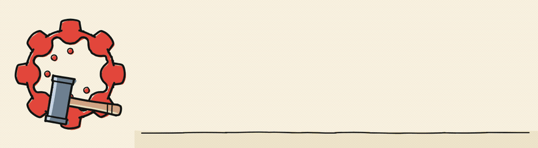
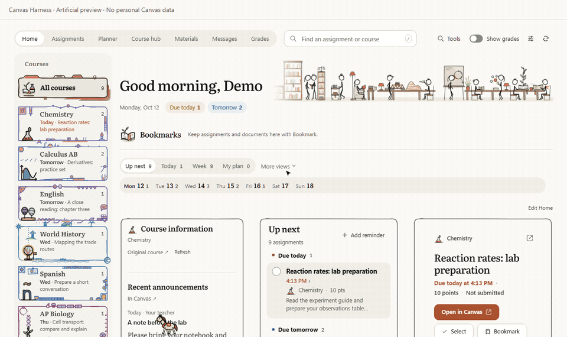
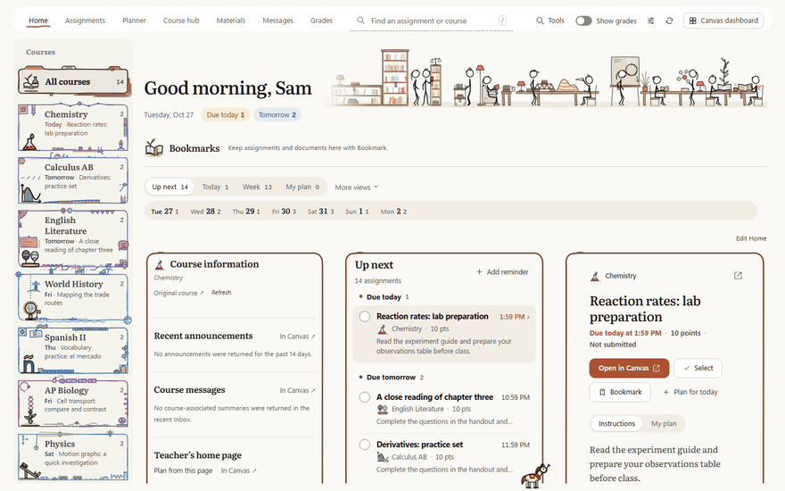

<h1 align="center">
  
</h1>

  <b>由你亲手打造的 Canvas 工作空间。</b> 
  灵感来自 AI 工作台：帮你更快找到要做的事、规划一周安排，让 Canvas 用起来更舒心。

  
  
  

  <a href="https://github.com/Flzsh/canvas-harness/releases/latest"><b>下载</b></a> ·
  <a href="INSTALL.md">安装</a> ·
  <a href="docs/GETTING-STARTED.md">快速开始</a> ·
  <a href="PRIVACY.md">隐私</a>

  

演示中使用的课程和作业均为虚构内容。

## 功能一览

<table>
  <tr>
    <td width="33%" valign="top">
      <h3>自己布置主页</h3>
      在课程内容旁添加模块：今日、本周、专注计时器、时钟、笔记、书签、成绩和消息。你可以调整模块大小，也可以拖动它们的位置。
    </td>
    <td width="33%" valign="top">
      <h3>每周计划</h3>
      把任务写成日常用语，拖到计划完成的那一天，然后勾选完成。Canvas 中的截止日期不会改变。
    </td>
    <td width="33%" valign="top">
      <h3>作业</h3>
      并排查看作业列表和说明，也能就近查看教师更新、书签，并在本地勾选完成状态。
    </td>
  </tr>
  <tr>
    <td valign="top">
      <h3>学习伙伴</h3>
      一只小马在模块间散步、提醒你接下来要做什么、陪你计时学习，并为完成的任务喝彩。它不会责备你，也可以随时关闭。
    </td>
    <td valign="top">
      <h3>自定义外观</h3>
      使用手绘课程插画、轮廓、颜色、文字大小和布局预设；也可以上传自己的 SVG 横幅、图标、边框和标题。
    </td>
    <td valign="top">
      <h3>工作时使用常用工具</h3>
      阅读时，可在侧边栏打开 Desmos、GPA 估算工具和 AI 助手。发送内容前，你可以选择要分享哪些资料。
    </td>
  </tr>
</table>

## 设置主页

点击“编辑主页”来启用或关闭模块。每个模块的三点菜单都可以调整宽度、让模块占据整行或整列，或将其移除。

要移动模块，按住它的标题，直到手绘圆圈闭合，然后拖动。可以将它放在其他模块旁边或下方，也可以放到所有模块上方，让它独占一行。“撤销移动”可以恢复原位置。

## 规划一周

  

输入“essay outline fri 45m #english”，任务就会安排到星期五，时长 45 分钟，并归入英语课程。你可以把任务卡拖到其他日期，也可以使用卡片菜单。已完成和已归档的任务会自动收起，需要时再查看。

## 阅读并完成作业

把教师更新、即将到期的作业和作业说明放在一起查看。你可以收藏有用的资料，也可以在本地标记作业已完成，包括在 Canvas 之外提交的作业。

阅读时，可以在侧边栏打开 Desmos、GPA 估算工具或 AI。使用 AI 时，先选择资料并检查上下文，再把问题发送到你选择的 AI 网站。

## 自定义外观

系统会自动为课程添加动态主题插画。“自定义外观”提供五个选项卡：布局、外观、插画、课程和小马。

你可以使用[插画技能](skills/canvas-harness-art/SKILL.md)，让 AI 根据课程描述生成素材包。生成后，通过“外观设置 → 快速上传”导入 `.chpack` 文件，预览并应用素材。

## 在 Chrome 或 Edge 中安装

1. 从[最新版本](https://github.com/Flzsh/canvas-harness/releases/latest)下载并解压扩展 ZIP 文件。
2. 打开 `chrome://extensions` 或 `edge://extensions`，启用“开发者模式”，然后选择“加载已解压的扩展程序”。
3. 选择包含 `manifest.json` 的文件夹，然后刷新 Canvas 页面。

支持 `*.instructure.com` 下使用 HTTPS 的学校网站。请查看[安装帮助](INSTALL.md)。

## 隐私

Canvas Harness 会读取课程内容，但不会更改作业提交或成绩。数据保存在浏览器中，并按账户隔离。默认情况下，在 Canvas 确认当前登录账户之前，不会显示任何已保存内容。

点击“发送”后，你选择的上下文才会被提交到 AI 服务商的网站；自动提供给 AI 的上下文不包含成绩和 GPA。详情请查看[隐私说明](PRIVACY.md)。

[用户指南](docs/GETTING-STARTED.md) · [主题](docs/THEMES.md) · [AI 指南](AI.md) · [问题反馈](https://github.com/Flzsh/canvas-harness/issues)

由 Flzsh 创建 · [GPL-3.0-only](LICENSE) · [第三方声明](extension/NOTICE.txt)
