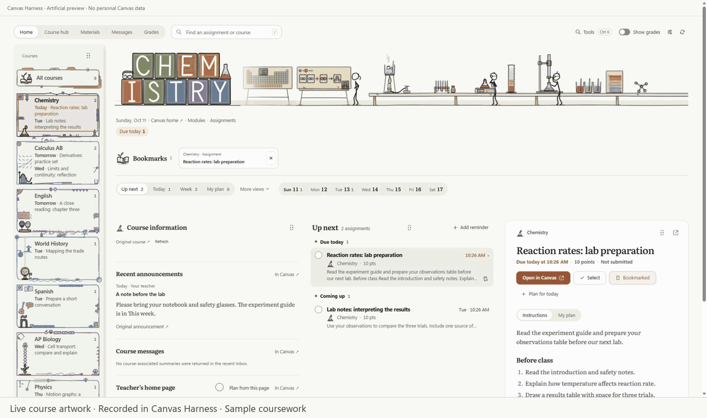
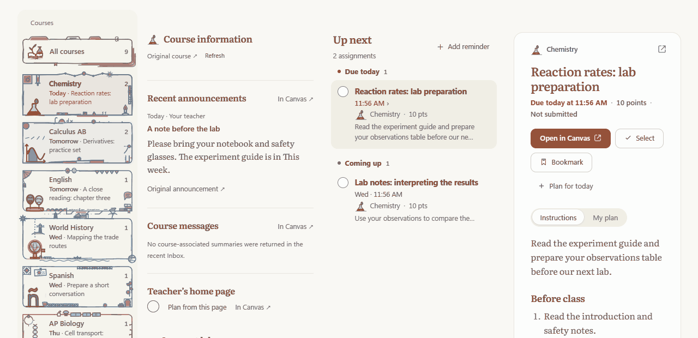

  

<h1 align="center">Canvas Harness</h1>

  Inspired by AI harnesses, Canvas Harness gives you a workspace you can make your own. Find your work faster, study the way you prefer, and make Canvas comfortable to use.

  <a href="https://github.com/Flzsh/canvas-harness/releases/latest">Latest GitHub release</a> ·
  <a href="INSTALL.md">Install</a> ·
  <a href="docs/GETTING-STARTED.md">Get started</a>

*The demos use fictional courses and assignments.*

## Your courses and work together

See teacher updates, upcoming work, and assignment instructions together. Bookmark useful materials and mark homework done locally, including work you submit outside Canvas.

Open Desmos, GPA estimates, or AI in a side dock while you read. For AI, select your materials, review the context, and send your question to your chosen AI website.

## Move courses and panels directly

Hold a course card or panel heading until it lifts, then drag and release. Reorder courses, swap panels, or stack them for more reading space. Undo move puts things back.

## Make it feel like your workspace

Courses get animated subject artwork automatically. Adjust the layout, text size, and colors, or upload your own SVG banners, icons, borders, and titles.

Describe your course to an AI using the [artwork skill](skills/canvas-harness-art/SKILL.md). Import the resulting `.chpack` through Appearance settings → Quick Upload to preview and apply the set.

## Install in Chrome or Edge

1. Download and extract the extension ZIP from the [latest release](https://github.com/Flzsh/canvas-harness/releases/latest).
2. Open `chrome://extensions` or `edge://extensions`, enable Developer mode, and choose Load unpacked.
3. Select the folder containing `manifest.json`, then refresh Canvas.

Works on HTTPS school sites under `*.instructure.com`. [Installation help](INSTALL.md).

## Privacy

Canvas Harness reads coursework without changing submissions or grades. Data stays in your browser, separated by account. Clicking Send places your chosen context on the AI provider's website; automatic context excludes grades and GPA. [Privacy details](PRIVACY.md).

[User guide](docs/GETTING-STARTED.md) · [Themes](docs/THEMES.md) · [AI guide](AI.md) · [Report a bug](https://github.com/Flzsh/canvas-harness/issues)

Created by Flzsh · [GPL-3.0-only](LICENSE) · [Third-party notices](extension/NOTICE.txt)
