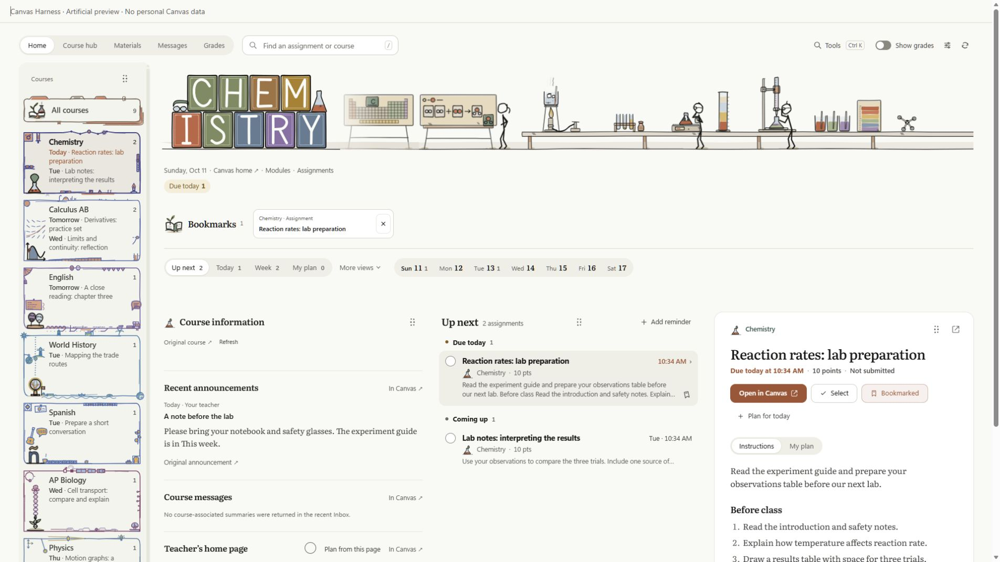
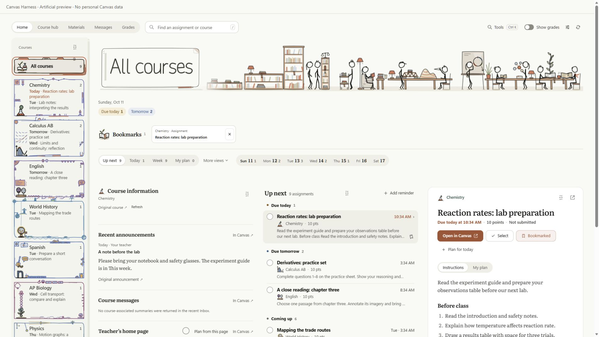
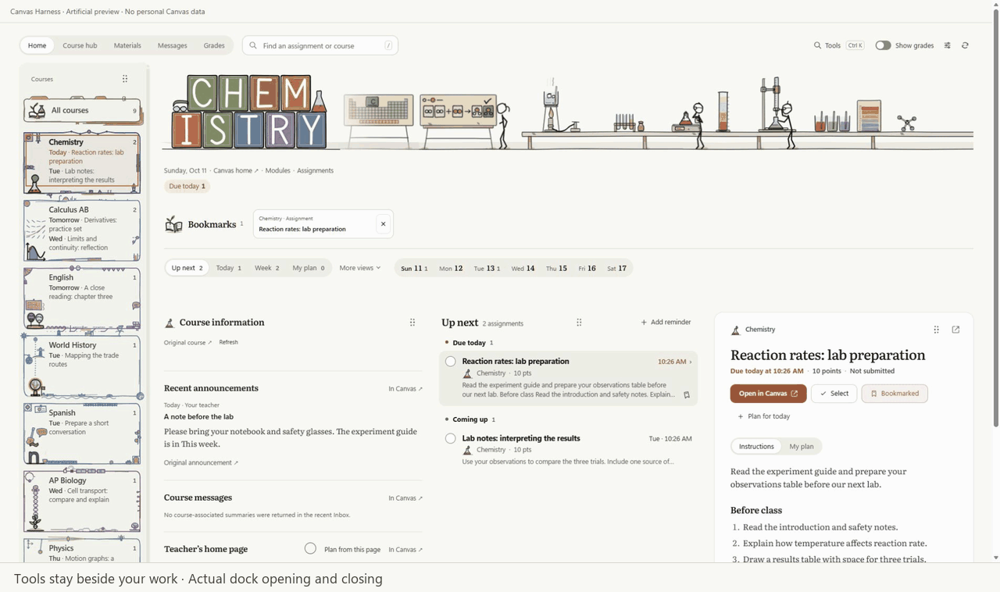

  

<h1 align="center">Canvas Harness</h1>

  Inspired by AI harnesses, Canvas Harness is built for higher efficiency, versatility, and aesthetic comfort in everyday coursework.

  <a href="https://github.com/Flzsh/canvas-harness/releases/latest">Download from GitHub</a> ·
  <a href="INSTALL.md">Install in Chrome or Edge</a> ·
  <a href="docs/GETTING-STARTED.md">Get started</a>

  

Keep your teacher's course page, upcoming assignments, and the instructions you are reading together. Open study tools beside them, arrange the workspace to suit the task, and give each course artwork of its own. Canvas Harness uses the Canvas account you are already signed in to.

*All screenshots and motion clips use artificial courses and assignments.*

## Three goals, in practice

| Goal | How Canvas Harness helps |
| --- | --- |
| Higher efficiency | See upcoming work alongside teacher information and assignment instructions. Bookmark useful materials, mark work done locally, and select coursework to prepare an AI question without copying each source by hand. |
| Versatility | Put panels beside one another or stack them. Use Desmos, customize GPA rules, or review selected text for an AI provider. Change course names, appearance, and artwork for your own account. |
| Aesthetic comfort | Recognize courses through coordinated drawings, choose comfortable spacing and typography, and adjust paper surfaces, contrast, borders, and motion. Living artwork can rest when you prefer a quiet page. |

## Your class, with the work beside it

On Home, choose a course to bring its teacher home page, recent announcements, and available course-associated message summaries alongside your work. Open an assignment to read its instructions in the workspace. Course hub, Materials, and Messages give you more room for the original information and links.

All courses brings your upcoming work together while keeping each subject recognizable. Bookmarks keep assignments and course resources close at hand.

Circles select items. A compact action island beside the dates offers **Use in AI**, **Archive**, and **Clear**, without moving the coursework below. **Archive** marks selected assignments done locally; **Bookmark** saves an item for later. Local completion does not submit homework or change Canvas grades. Use the original Canvas page for submissions and official status.

## Make the artwork yours

Canvas Harness automatically matches course names and familiar codes to **22 subject presets**. They cover mathematics, sciences, English, writing, reading, languages, and history, with AP science and Calculus AB/BC variants. Unfamiliar subjects receive a general illustration and a simple sketched outline. Individual courses without matching title artwork receive a reusable illustrated label with their displayed course name. All courses welcomes you with a greeting that changes with the time of day, beside its overview artwork.

Upload animated SVG banners, icons, borders, and custom titles for individual courses or All courses. Your uploads take priority over the bundled artwork.

### Describe a course, receive one artwork pack

The included [artwork skill](skills/canvas-harness-art/SKILL.md) helps an AI assistant make a coordinated, hand-drawn banner, icon, and border. The course name is drawn into the banner.

1. Paste the [complete artwork prompt](skills/canvas-harness-art/PROMPT.md) into your assistant, or [install the skill folder](skills/canvas-harness-art/README.md#using-it) in an assistant that supports skills.
2. Describe what the course studies this term, give its displayed name and a color, and ask for one **.chpack** file.
3. Open **Appearance settings → Quick Upload**. Choose or drop the file, or paste the complete pack and choose **Review pack**.
4. Preview the drawings, check each course destination, and uncheck anything you do not want. **Apply** saves the selected pieces together. **Undo last pack** restores the affected artwork during the current workspace session if those artwork fields have not since changed.

Try the [astronomy example pack](skills/canvas-harness-art/examples/astronomy/astronomy.chpack) by mapping it to a course in the preview before applying. Quick Upload bundles banners, icons, and borders. If the banner includes its drawn name, choose **Course artwork → Course title → Already drawn in banner** to avoid a second title over it. Separate title SVGs use the individual uploader.

Download the [artwork skill ZIP](https://github.com/Flzsh/canvas-harness/releases/download/v2.21.1/Canvas-Harness-Art-Skill-2.21.1.zip), or use its folder in the repository. It is separate from the extension install ZIP. See [Themes and artwork](docs/THEMES.md) for the complete workflow, motion controls, and upload limits.

## Move courses and panels directly

On Home, hold a course card or panel heading until it lifts, then drag toward a highlighted destination and release. Reorder your courses, put instructions beside assignments, or stack panels to give a document more space. Every drag needs a separate hold; releasing returns the workspace to normal use. **Undo move** restores the previous arrangement.

The clip shows keyboard moving: Space lifts, an arrow previews a swap, and Enter places. Pointer moving uses the same destinations. Keyboard controls and cancellation are explained in [Get started](docs/GETTING-STARTED.md#arrange-your-workspace).

**Appearance settings** opens beside the page. Start with Studio, Study, or Focus, then adjust the course sidebar or strip, surfaces, borders, banner size, typography, and density. Rename, recolor, reorder, or hide courses locally. Changes are saved for the current Canvas site and account.

## Study tools that stay beside the page

**Tools** opens a side dock while the main workspace stays usable.

| Tool | What you can do |
| --- | --- |
| Calculator | Use Desmos graphing or scientific calculators. Desmos is an external website; Canvas Harness passes it no Canvas coursework. |
| GPA | Compare 4.0 and 4.3 estimates. Adjust credits, cutoffs, grade points, weighting bonuses, caps, and included courses, or try what-if grades. These are local estimates, not official transcript calculations. |
| AI | Review selected assignments and materials, add your question, and insert the prepared text into an AI provider's website. |

Choose ChatGPT, Claude, Gemini, or a provider under **More**, and sign in on its website. **Review text to share** shows the selected content and any missing or shortened parts. **Send**, or **Enter** in the question box, inserts your prepared question and text; **Shift + Enter** adds a line. Review the draft on the provider site by default. **Send automatically after inserting** is optional.

Small PDFs are converted to bounded text extracts locally; the AI handoff does not upload the original PDF file. Website insertion asks for optional access to the chosen provider's site. Browser policies and provider editors can prevent insertion, so **Copy** and manual paste are available. See [Study with AI](AI.md) for limits and permissions.

## Install and take your first look

Download the extension ZIP from [the latest GitHub release](https://github.com/Flzsh/canvas-harness/releases/latest), or use the [source repository](https://github.com/Flzsh/canvas-harness). Follow [INSTALL.md](INSTALL.md), sign in to Canvas, refresh the page, then follow [Get started](docs/GETTING-STARTED.md).

Chrome Web Store and Edge Add-ons listings are not published yet. The current installation route is GitHub and **Load unpacked**.

The extension is designed for desktop Chrome and Edge on HTTPS school Canvas sites under <code>*.instructure.com</code>. Custom Canvas domains and self-hosted sites are outside the current support scope. School API access, managed-browser policies, and AI provider editors vary. Automated checks and artificial previews do not establish compatibility with every school or provider.

## Privacy and your Canvas account

Canvas requests use your existing signed-in session and are read-only. Canvas Harness has no developer-operated server or telemetry collector. Fetched Canvas information and your settings, notes, bookmarks, local completion, GPA preferences, and imported art stay in browser storage, separated by Canvas site and account.

**Grades are hidden by default; grade data can still be in the local cache.** Showing GPA in the dock does not change the main grade visibility switch.

Opening an AI website or reviewing selected context does not share that coursework with the provider. Clicking **Send** transfers the prepared question and selected instructional text into its website's draft. The provider may receive that text before you submit the chat. Grades and local GPA data are excluded from the AI context builder. Review documents for private details before sharing.

Personal backups can contain your notes and artwork; keep them private. Read the [Privacy notice](PRIVACY.md) for storage, PDF processing, provider access, and data removal.

## Development and feedback

Node.js 22 or newer is required for local development; no package installation is needed.

~~~sh
npm test
npm run check
npm run build
npm run preview
~~~

The build writes an extension ZIP and a SHA-256 release manifest to <code>dist/</code>. The artificial preview is excluded from the install ZIP.

See [Release checks](docs/TESTING.md) for the tested workflows and the limits of that verification.

Report bugs or suggest improvements through [GitHub Issues](https://github.com/Flzsh/canvas-harness/issues). Include browser and extension versions and steps to reproduce the problem; leave personal coursework, grades, backups, and private artwork out of public reports.

## License

Canvas Harness is licensed under [GPL-3.0-only](LICENSE). Original creator: Flzsh.

GPL permits commercial use; this project adds no noncommercial restriction. Earlier releases distributed under MIT retain their original license. Bundled third-party components retain their own notices and licenses, including the Literata fonts, PDF.js, and explicitly retained MIT components. See [NOTICE.txt](extension/NOTICE.txt).
