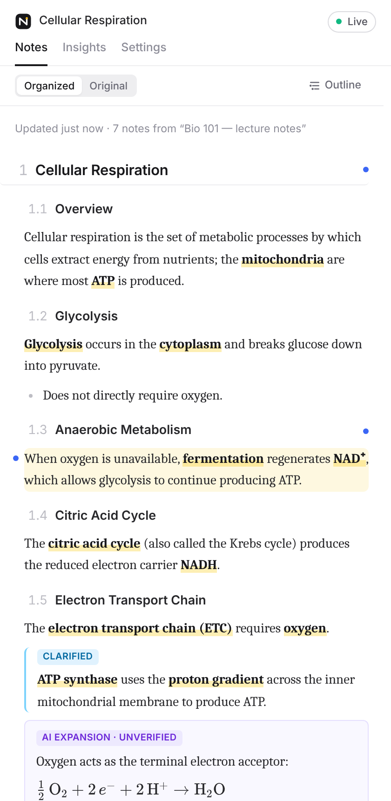
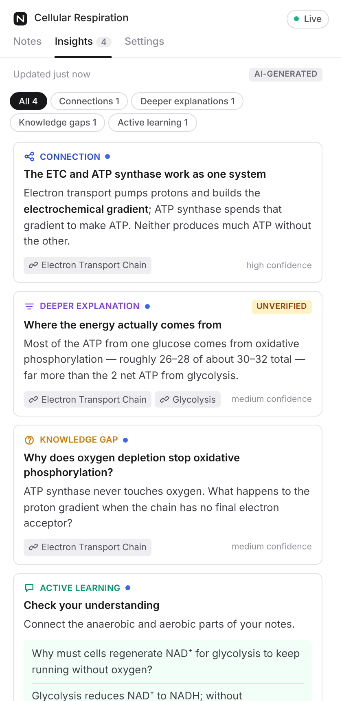
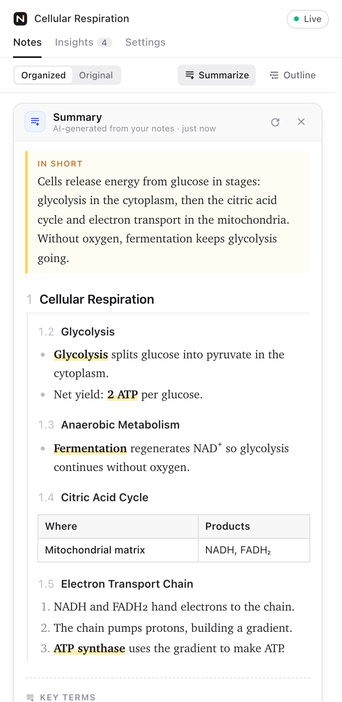

# NotePilot AI

A Chrome extension that reads the Google Doc you're typing in and keeps a live, rewritten, organized version of it in the Chrome side panel, with AI insights alongside. One click gives you a concise summary and saves everything to a separate Google Doc. **It never modifies your notes.**

<p>



</p>

- **Two parallel documents.** Your Google Doc stays the raw, messy source of truth. The side panel holds a separately maintained organized document: headings, merged ideas, expanded shorthand, tables and equations.
- **Incremental, not regenerated.** Each change is diffed at paragraph level, and the model returns a *patch*: extend, rewrite, move, merge, split or delete specific sections and passages, all addressed by stable IDs. New facts go where they belong conceptually, not at the bottom.
- **Faithful.** Every organized passage cites the source paragraphs it came from. You can click to see them, and passages are labelled as *your notes*, *AI clarification* or *AI expansion (unverified)*. A deletion that would lose any of your content is reverted. Anything the model fails to represent is repaired, or shown verbatim, so nothing is silently dropped.
- **Finishes what you didn't.** Sentences you cut off mid-way are completed, and ideas you started but didn't write out are developed (Settings → Writing → *Finish incomplete notes*: Off / Finish / Develop). The words the AI added are highlighted, so you always know which part you wrote. The rewrite favours short sentences, plain words, a logical order and lists, tables or steps where they make an idea easier to follow.
- **Structured, not just reworded.** Comparisons become tables, processes become numbered steps, parallel points become (nested) lists, key terms become definitions, and notes are cut into sections and subsections so each one covers a single idea.
- **Summary + Google Doc.** *Summarize* (Notes toolbar) shows a short version of the organized notes in the same outline: the same numbered sections, each cut down to a few bullets, steps or a small table, plus a one-line overview, a key-terms table and what to review next. Section headings link to the full notes. The same click saves the summary, the organized notes and the insights to a companion Google Doc (headings show up in the Docs outline). Later clicks update that same doc, and opening it doesn't make the panel treat it as notes: the panel keeps showing the notes it came from.
- **Hands-free after setup.** Adaptive polling, debouncing on typing pauses, single-flight jobs, stale-result rejection, cancellation, back-off, offline recovery.

---

## Quick start

NotePilot lives in the `notepilot/` folder of the [Canvas Harness](../README.md) repository and is built and loaded separately from Canvas Harness. Run the commands below from that folder.

Requirements: **Google Chrome 116+**, Node.js 22+, a Google Cloud project (free), and an OpenAI-compatible model endpoint (OpenAI, Anthropic's OpenAI-compatible API, OpenRouter, Ollama…) or the included proxy server.

```bash
npm install
npm test                 # unit + engine acceptance simulation + proxy server tests
```

### 1. Google OAuth setup (one time, ~5 minutes)

`chrome.identity` needs an OAuth client that is bound to your extension's ID, so the ID has to be fixed first:

```bash
cd extension
npm run setup:oauth      # creates a key, writes .env.local, prints your Extension ID
```

Then in the [Google Cloud Console](https://console.cloud.google.com):

1. **APIs & Services → Library →** enable **Google Docs API** and **Google Drive API** (Drive is only used to save the companion Google Doc).
2. **OAuth consent screen:** User type *External* (or *Internal* for a Workspace org). Under **Data Access**, add the scopes `https://www.googleapis.com/auth/documents.readonly` and `https://www.googleapis.com/auth/drive.file`, and add your Google account as a **test user**.
3. **Credentials → Create credentials → OAuth client ID →** Application type **Chrome Extension**, Item ID = the Extension ID printed above.
4. Record the client ID:
   ```bash
   npm run setup:oauth -- --client-id=1234-abc.apps.googleusercontent.com
   ```

### 2. Build and load

```bash
npm run build            # → extension/dist
```

Open `chrome://extensions`, turn on **Developer mode**, click **Load unpacked**, and select `extension/dist`. The ID shown must match the one from step 1.

### 3. Use it

1. Open a Google Doc and click the NotePilot toolbar icon (or press **Alt+Shift+N**).
2. The panel walks you through three steps: **Sign in with Google** (read-only), **connect an AI model** (key + model names, then *Connect & test*), and **allow sending notes**.
3. Type. That's it.
4. Optional: click **Summarize** in the Notes toolbar. The first time, Google asks you to allow NotePilot to *create files* in Drive (it can only see and change files it creates).

> **Models.** Defaults are `gpt-5.4-mini` (rewriting) and `gpt-5.4` (insights). Provider presets are included, and any OpenAI-compatible model name works. A fast model keeps the panel current; a stronger one gives better insights. Edit the per-token prices in Settings → Cost limits to match your provider.

---

## How it works

```
Google Doc (read-only)                         Side panel (React)
──────────────────────                         ─────────────────────────────────────────────
documents.get?fields=revisionId  ◄── adaptive poll (2–5 s while typing, slower when idle)
documents.get (full) on change   ──► parse → paragraph blocks → stable IDs (LCS + fuzzy match)
                                        │
content script: "user is typing" ──► debounce: wait for a typing pause (max-wait while typing)
  (activity only, never content)        │
                                        ▼
                         diff(processed → current): added / modified / removed blocks
                                        │
                         context: organized doc (full, or relevant sections + previews
                                  for long docs) + changes + neighbouring blocks
                                        │
                         fast model → JSON patch ops ─► zod validation ─► apply with integrity rules
                                        │                                   (refs, cycles, coverage,
                                        │                                    no-loss, de-dup)
                                        ▼
                         organized doc v(n+1) → IndexedDB → copy-on-write React render
                                        │                    (only changed nodes update)
                                        ▼
                         insights pipeline (deeper model, low priority, preemptible)
```

**Key decisions**

| Concern | Decision |
|---|---|
| No keystroke stream from Google Docs | Poll the Docs REST API. A cheap `fields=revisionId` check runs every 2–5 s while active, and a full fetch only happens when the revision changes. A tiny content script reports *that* you're typing (never *what*), so polling speeds up and typing pauses are detected. No DOM scraping. |
| MV3 service workers sleep after ~30 s | The sync engine runs in the side panel page, which stays alive while it's open. When you close it, sync pauses. When you reopen it, it catches up from the persisted snapshot. |
| Stable identity for paragraphs | Docs has no paragraph IDs. They're rebuilt each fetch: common prefix/suffix, then LCS on content hashes, then moved-block detection, then fuzzy matching inside changed regions. Edits keep their ID, and pure moves trigger no AI work. |
| Incremental rewriting | The model emits ops (`create_section`, `update_unit`, `move_unit`, `delete_section`, …) against stable IDs. Merges and splits are compositions of these. Each op is validated individually. |
| Content integrity | Every `user`/`clarification` passage must cite valid source IDs. Deletions that would orphan a source paragraph are reverted. Passages whose sources were deleted are removed (*"remove content only when the notes no longer support it"*). Uncovered paragraphs get one targeted repair call, then a verbatim "Not Yet Organized" fallback that a later pass reorganizes. |
| Concurrency | One rewrite in flight per doc. Results are rejected if the organized doc changed underneath them. Insights are aborted when a rewrite is needed. A Web Lock elects one leader panel per doc across windows, and the others mirror it over a BroadcastChannel. |
| Long documents | The whole organized doc is sent while it fits about 28k characters. Beyond that, relevant sections go in full (by citations, source neighbours and topic overlap) and the rest as previews. Initial builds of long docs are batched (about 8k characters of new text per call). |
| Stable UI | Copy-on-write patches keep object identity for unchanged passages, so memoized rows don't re-render. Keys are stable IDs, CSS scroll anchoring holds your reading position, collapse state persists per doc, highlights are a one-off soft fade, and nothing ever calls `focus()`. |

### Privacy & safety

- **Your notes are read-only by construction:** they are read with the `documents.readonly` scope, and the Docs client issues only `GET`. Saving the companion Google Doc uses `drive.file`, which Google limits to files NotePilot created itself, so it cannot change your notes; it's requested only when you first click *Summarize*, uses only Drive's upload endpoint, and refuses to target the doc it reads from. `tests/readonly.test.ts` fails the build if a Docs write endpoint, a broader scope or another Drive endpoint is ever introduced.
- **Consent first:** no note text is sent anywhere until you approve the specific AI endpoint. Changing the endpoint asks again. You can also exclude documents, or require approval per document.
- **Prompt-injection hardening:** note text travels only as JSON-encoded data, separate from the instructions, and the system prompt treats it as untrusted. Model output is schema-validated, rendered as restricted markdown with no HTML and no images (so injected image links can't exfiltrate data), and links require a click. The extension CSP forbids remote scripts and images.
- **Redaction (on by default):** email addresses, phone/ID-number patterns and card numbers are replaced before sending. Numbers, units, dates and equations are kept intact.
- **Secrets:** your API key lives in `chrome.storage.local` (never synced) and is sent only to the endpoint you configured. For shared deployments, use the proxy server so the provider key never reaches the browser.
- **Local data:** organized notes, source mappings and the response cache live in IndexedDB. You can turn persistence off or delete everything from Settings → Privacy.

---

## Optional: the proxy server

For a class or team: one provider key on a server, per-user tokens, rate limits, daily token budgets, response caching and usage logging (counts only, never content).

```bash
cd server
cp .env.example .env      # set UPSTREAM_API_KEY, ACCESS_TOKENS=alice:<long-random-token>,...
npm run build && npm start   # http://localhost:8787
```

In the extension: Settings → AI model → **NotePilot server**, then enter the server URL (`http://localhost:8787/v1`) and your token. Endpoints: `POST /v1/chat/completions`, `GET /v1/usage`, `GET /health`. Deploy it behind HTTPS for anything beyond localhost.

---

## Testing

```bash
npm test                  # 94 extension tests + 7 server tests
cd extension && npm run e2e   # real Chromium end-to-end run (needs a Chromium/Chrome binary; CHROMIUM_PATH=…)
```

| Suite | What it covers |
|---|---|
| `docParser`, `identity` | Docs API → blocks (headings, lists, tables, chips, tabs); stable IDs across inserts, edits, deletes, moves and duplicates; a 3,000-paragraph doc diffs in < 1.5 s |
| `patch` | refs, cycles, depth, revert of lossy deletes, source reconciliation, number-aware de-duplication, merge/split/move, coverage + fallback |
| `completion` | finishing cut-off sentences and developing half-written ideas (prompt rules per setting), highlighting AI-added words, markers never shown or exported as-is, text NotePilot shortens is labelled so the model doesn't report it as "truncated" |
| `context` | injection-safe payloads, redaction, settings → prompt, relevant-section selection for long docs |
| `acceptance` | **Spec §15 workflow** on the real `SyncEngine` with a fake Docs backend and scripted model: organize → place a new fact at its conceptual location → update an earlier section in place → reconcile an edited statement → reconcile a deleted one (including the AI expansion anchored to it) → insights update → only GETs to the doc → latency p90 ≤ 15 s |
| `engine` | stale-result rejection, insight cancellation, Docs 429 back-off with Retry-After (not shortened by typing), offline recovery, invalid AI output → verbatim fallback → later self-healing (edits made during a failing call stay pending), repair calls, consent and budget gates, idle quota use (also while paused), resume from IndexedDB, batched long-doc builds, revision-check fallback, undo keeps paragraph identity |
| `ai` | OpenAI-compatible request shape, provider quirks (`max_completion_tokens`, temperature), error mapping, retry with validation feedback, cost tracking, cache |
| `summaryExport` | structure rules (tables, steps, lists, sections), summary follows the notes outline (order, numbers, parent headings), length limits that keep lists and tables valid, validation and pipeline, companion-doc HTML (outline headings, tables, labels, highlighted completions, math as text), Drive save: create, update the same doc, never the source doc, deleted/trashed doc, disabled API, refused permission, token refresh |
| `readonly` | static guarantees: read-only Docs scope and GET-only Docs client, `drive.file` as the only Drive scope, only the upload endpoint, content script never reads or alters the editor |
| `server` | auth, forwarding with the server key, cache, rate limit, daily budget, model allowlist, error passthrough |
| `e2e/run-e2e.mjs` | The **built extension in real Chromium**: Docs REST API routed to a mutable fake document, AI endpoint routed to a scripted model, and the actual side panel driven through the acceptance scenario, plus DOM-node identity, scroll preservation, collapse persistence, source inspector, multi-window leader election and first-run consent. Screenshots go to `e2e/screenshots/`. |

See [`docs/VERIFICATION.md`](docs/VERIFICATION.md) for what was actually verified and what was not.

---

## Project layout

```
extension/
  manifest.base.json        MV3 manifest (client ID + key injected at build from .env.local)
  src/core/                 pure logic: types, Docs parser, identity/diff, patch engine, schemas,
                            prompts, context builder, insights, redaction, export
  src/engine/               SyncEngine (polling, debouncing, jobs, integrity, metrics) + state
  src/google/               chrome.identity auth, read-only Docs API client, companion Google Doc export (drive.file)
  src/ai/                   OpenAI-compatible client, rewrite/insight pipelines, usage tracking
  src/storage/              IndexedDB (docs, cache), chrome.storage settings
  src/sidepanel/            React UI: Notes (organized/original/outline), Insights, Settings, setup
  src/content/activity.ts   typing-activity signal (no content access)
  src/background/index.ts   opens the side panel from the toolbar button
  tests/  e2e/  scripts/setup-oauth.mjs
server/                     Node.js model proxy (no runtime dependencies)
docs/                       verification report, screenshots
```

## Troubleshooting

- **"Sign in with Google" fails with `bad client id` / `OAuth2 not granted`:** the client must be of type *Chrome Extension*, its Item ID must equal the ID shown in `chrome://extensions`, and you must rebuild after `setup:oauth`.
- **403 "Google Docs API has not been used in project…":** enable the Docs API in the same Cloud project as the OAuth client.
- **"Google Doc not saved: The Google Drive API is not enabled…":** enable the Google Drive API in the same Cloud project, then click *Summarize* again.
- **"Permission to create Google Docs was not granted":** click *Summarize* again and approve the *create files* permission (it can only touch files NotePilot creates).
- **Several "— NotePilot notes" docs in Drive:** earlier versions followed the companion doc when you opened it and made a new one on each Summarize there. That is fixed; you can delete the extra copies in Drive (keep the one the panel's *Open* button links to).
- **Edits in the companion Google Doc disappeared:** that doc is regenerated each time you click *Summarize*. Edit your original notes instead, or copy the doc (File → Make a copy) to keep a version.
- **School or work Google account blocked:** Workspace admins can block unverified third-party apps. Ask your admin to allow the OAuth client, or use a personal account for testing.
- **Panel says "AI provider rejected the API key":** re-enter the key in Settings → AI model and press *Connect & test*.
- **Nothing updates:** check the status pill. *Paused*, *Setup*, *Limit* and *Excluded* each have a one-click fix in the banner. Settings → Diagnostics shows poll interval, request rates and measured latencies.
